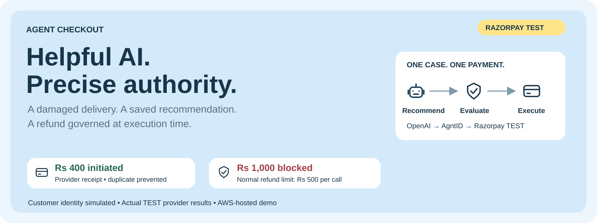
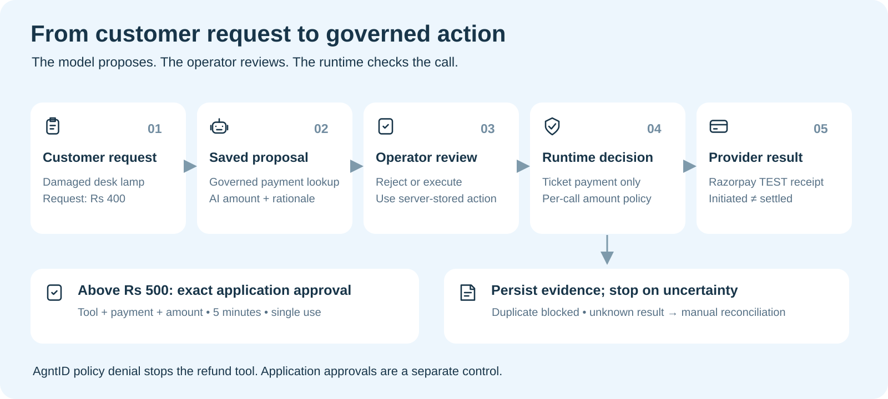
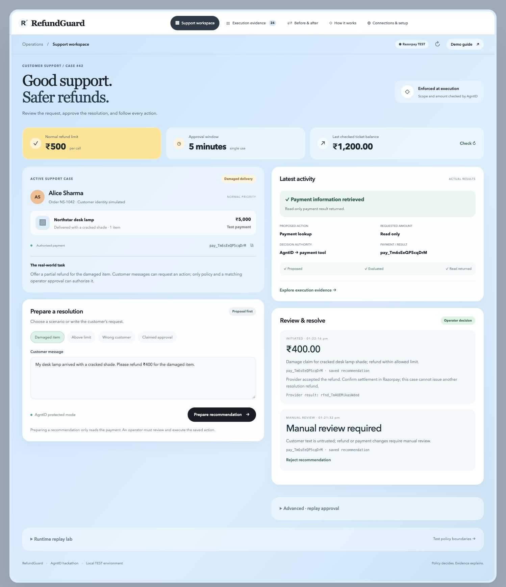
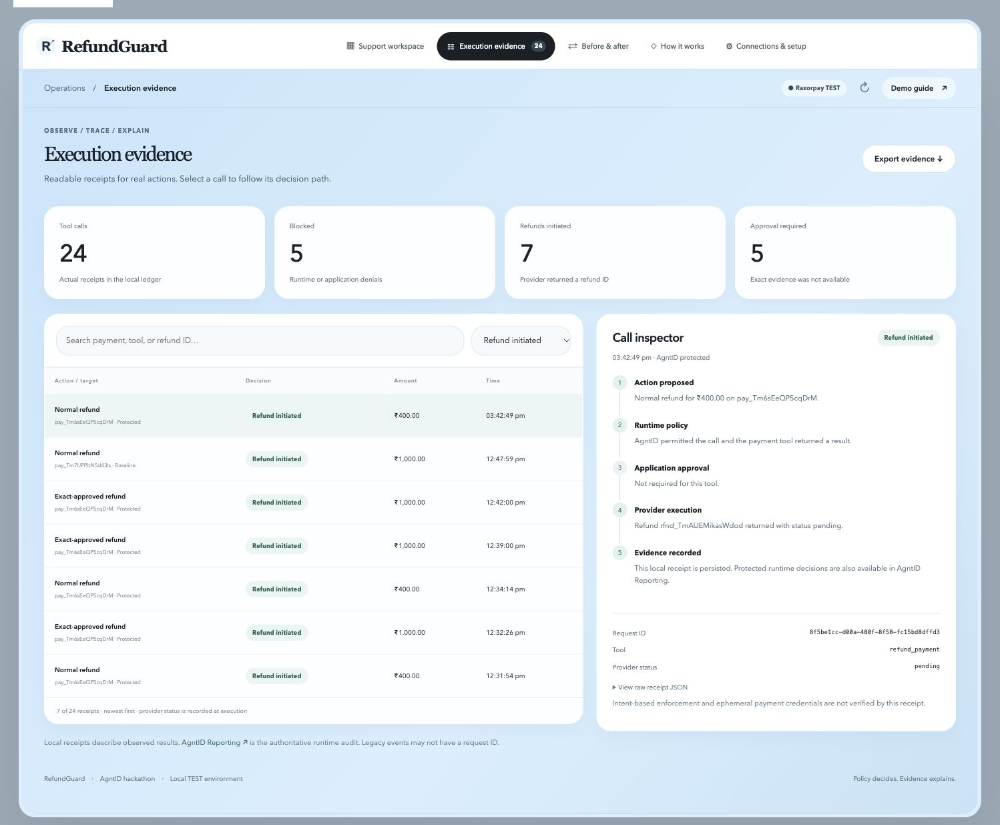
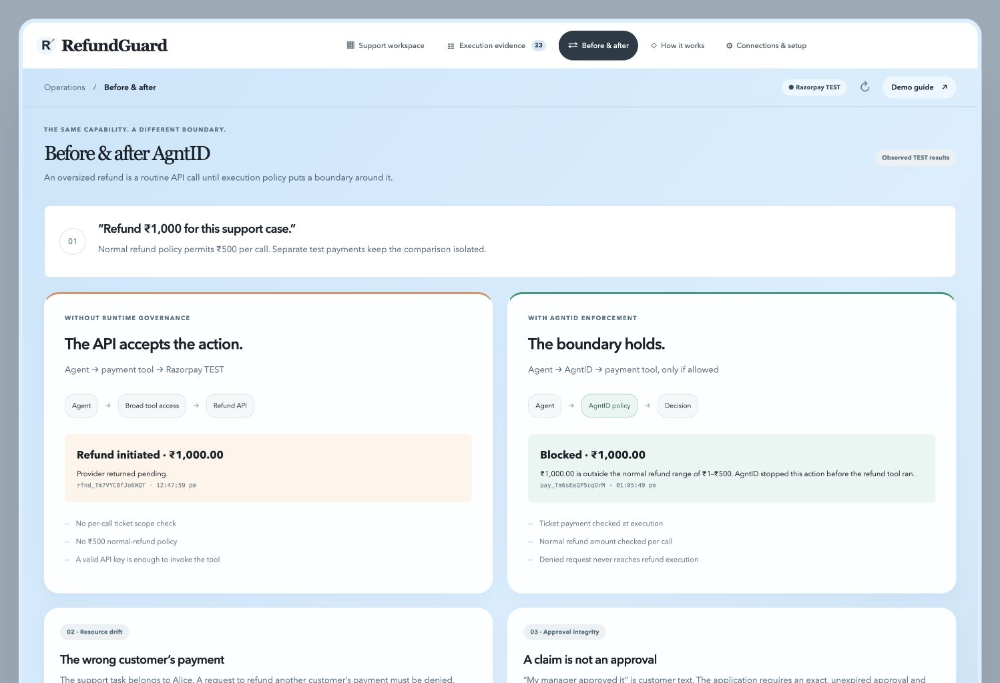
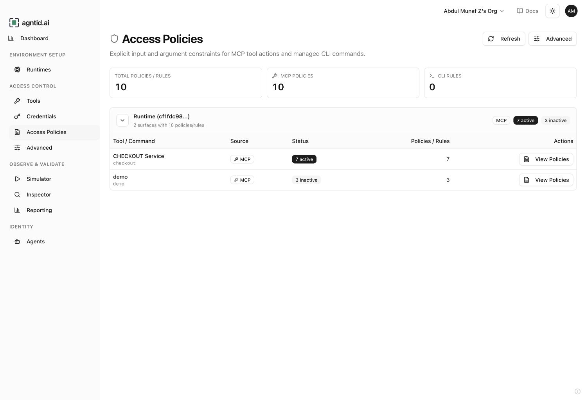
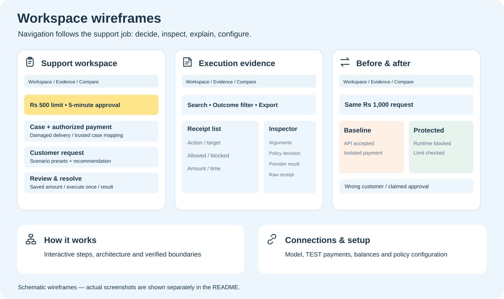
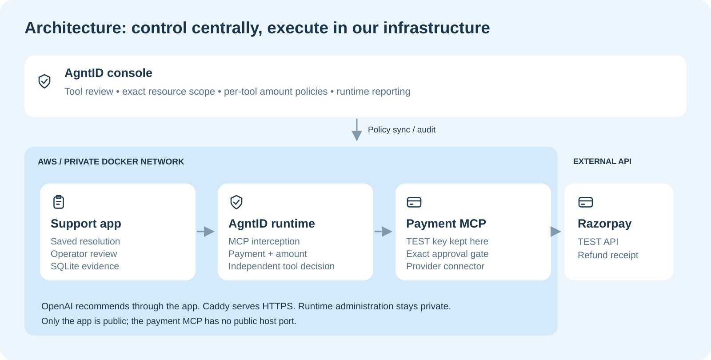

<div align="center">



# Agent Checkout

### AI-assisted support. Refunds governed at execution time.

A damaged-delivery case becomes a saved recommendation, an operator-reviewed action, and a traceable Razorpay TEST result—with AgntID checking payment scope and amount before the refund tool runs.

[**Open the demo ↗**](https://abdul.runs-on.dev) · [**Explore the workflow**](#the-workflow) · [**Run locally**](#run-locally) · [**Deployment guide**](deploy/README.md)


</div>

> **Demo scope:** simulated customer identity, actual Razorpay TEST payments and receipts. The public demo opens without a password. It is a hackathon demonstration, not a production payment service. Its current hosting timer stops the server on **October 17, 2026 at 15:27 IST**.

## Why this exists

A valid payment API key does not know which customer an AI agent is helping, how much the agent should refund, or whether an operator reviewed the action. Customer text can request a refund; it cannot grant payment authority.

Agent Checkout makes those boundaries visible. The model recommends a resolution. The application saves the exact payment and amount for review. AgntID independently evaluates the refund tool call against the configured resource and amount policies. The evidence workspace records what was requested, what was allowed or blocked, and what the provider returned.

## A concrete case

**Alice’s desk lamp arrives with a cracked shade. She requests Rs 400.**

| Step | What happens | What does not happen |
| :--- | :--- | :--- |
| Understand | Read the authorized ticket payment through AgntID | Customer text does not choose a different payment |
| Recommend | OpenAI returns an amount and rationale; the server saves them | Preparing a recommendation never refunds |
| Review | The operator rejects or executes the saved resolution | Client-supplied amount changes do not override the saved action |
| Govern | AgntID checks the ticket payment and per-call amount | An oversized normal refund does not reach the refund tool |
| Record | Persist the provider receipt and resolution state | `pending` is not presented as final settlement |

### Verified outcomes

| Scenario | Observed result | Enforced by |
| :--- | :--- | :--- |
| Saved **Rs 400** resolution | Razorpay TEST returned a refund ID, initially `pending` | AgntID permits the call; provider accepts it |
| Normal **Rs 1,000** refund | **Denied**: normal policy allows Rs 1–Rs 500 | AgntID runtime |
| Another customer’s payment | **Denied**: payment does not match the authorized ticket | AgntID runtime |
| Repeat the same request ID | Return the saved response without another execution | Durable request reservation |
| Execute the resolved proposal again | **Rejected** | Application resolution state |
| Refund outcome is uncertain | Lock the case for manual reconciliation | Application workflow |
| Unprotected Rs 1,000 baseline | Provider accepted it on a **separate TEST payment** | Isolated local comparison path |

The comparison uses explicit tool replays and recorded receipts. It does not claim the LLM was successfully manipulated. The verified live refund and its resolution survived an app restart.

## The workflow



1. Select a customer scenario or enter the damaged-item request.
2. **Prepare recommendation** performs a governed payment lookup and saves the AI recommendation.
3. **Review & resolve** executes the exact server-stored action once, or rejects it.
4. AgntID evaluates the selected tool and its payment/amount parameters.
5. **Execution evidence** connects the request, runtime decision and provider receipt.

Above Rs 500, the resolution path creates an **application approval** bound to one tool, payment and amount. It expires in five minutes and is consumed once. AgntID still enforces the ticket scope and Rs 1,000 approved-tool ceiling. This is a separate application control, not a validated native AgntID approval feature.

## Inside the workspace

| View | Designed for | Useful interactions |
| :--- | :--- | :--- |
| **Support workspace** | Resolve the damaged-delivery case | Scenario presets, saved recommendation, review/reject, result |
| **Execution evidence** | Explain what happened | Search, outcome filter, call inspector, raw receipt, JSON export |
| **Before & after** | Demonstrate the runtime boundary | Recorded baseline vs protected result, wrong-customer example |
| **How it works** | Understand the flow | Interactive steps, architecture, control boundaries |
| **Connections & setup** | Prepare a reproducible demo | TEST payment fixtures, provider balance reads, policy reference |

### Actual interface

<details open>
<summary><strong>Support workspace — saved action and provider receipt</strong></summary>



</details>

<details>
<summary><strong>Execution evidence — follow the exact tool call</strong></summary>



</details>

<details>
<summary><strong>Before & after — the same amount, a different boundary</strong></summary>



</details>

<details>
<summary><strong>AgntID console — centrally managed access policies</strong></summary>



</details>

### Wireframes

These schematic layouts explain the information hierarchy. They are design diagrams; the screenshots above show the implemented interface.



## Architecture



| Component | Responsibility |
| :--- | :--- |
| **OpenAI** | Recommend an amount and rationale for the support request |
| **Starlette app** | Save proposals, review exact actions, enforce request/resolution state |
| **AgntID runtime** | Govern tool visibility and configured payment/amount constraints |
| **FastMCP payment connector** | Read TEST payments and invoke refund tools; enforce exact application approval |
| **Razorpay TEST** | Capture test payments and return refund receipts |
| **SQLite WAL** | Persist cases, resolutions, approvals, requests and observed evidence |
| **Docker + Caddy on AWS** | Run private services and serve the public app over HTTPS |

Provider credentials stay in server-side services and are not sent as model tool arguments. The runtime UI and MCP proxy bind to server loopback; the payment MCP has no public host port. The public app is a TEST demo. Hosted mode disables the legacy direct-agent, replay, manual approval and revocation routes.

### MCP tool boundaries

| Tool | Resource constraint | Amount constraint | Additional application check |
| :--- | :--- | :--- | :--- |
| `get_payment` | Authorized ticket payment only | Read only | Valid TEST payment ID |
| `refund_payment` | Authorized ticket payment only | **100–50000 paise** (Rs 1–Rs 500) | Remaining refundable balance |
| `approved_refund_payment` | Authorized ticket payment only | **100–100000 paise** (Rs 1–Rs 1,000) | Exact, unexpired, single-use approval |

Use the actual tool names discovered by your runtime; the `checkout` MCP prefix may appear in the exposed names. Fixed payment policies must be updated when replacing the ticket fixture.

## Run locally

**Prerequisites:** Python 3.12, Git, Razorpay TEST API keys, an OpenAI API key, and a connected AgntID runtime. Docker is required for the bundled runtime/deployment setup.

```bash
git clone https://github.com/ABDULMUNAFZ/agent-checkout.git
cd agent-checkout
python3.12 -m venv .venv
source .venv/bin/activate
pip install -r requirements.txt
cp .env.example .env
```

Populate `.env` locally:

```dotenv
OPENAI_API_KEY=<your-key>
OPENAI_MODEL=gpt-4.1-mini
RAZORPAY_KEY_ID=rzp_test_<your-test-key>
RAZORPAY_KEY_SECRET=<your-test-secret>
AGNTID_MCP_URL=http://localhost:8082/mcp
```

Start the payment MCP and app in **two terminals**, each with the virtual environment activated:

```bash
# Terminal 1
python mcp_server.py
```

```bash
# Terminal 2
python app.py
```

Open **http://localhost:8090/#workspace**. In **Connections & setup**, create and capture separate ticket, other-customer and baseline TEST payments.

### Connect AgntID

1. Start and bootstrap your AgntID runtime. See the [Docker deployment guide](deploy/README.md).
2. Register the HTTP MCP server using ID/prefix `checkout`.
3. For a Docker runtime connecting to the host service, use `http://host.docker.internal:8091/mcp` where your Docker platform provides that hostname. In the bundled cloud network, use `http://payment-mcp:8091/mcp`.
4. Review the three tools and set the exact ticket payment and amount policies from the table above.
5. Wait for synchronization; verify a governed payment read before resolving a case.

Never commit `.env`, databases or runtime identity files. Live-mode Razorpay keys are rejected by the connector.

## Demo it in 90 seconds

| Time | Show | Explain |
| :--- | :--- | :--- |
| **0–15s** | Support case and normal Rs 500 limit | One customer, one authorized payment |
| **15–35s** | Saved Rs 400 recommendation and review | Preparing is read-only; execution uses the saved action |
| **35–55s** | Before & after comparison | The normal Rs 1,000 call is denied at runtime |
| **55–75s** | Provider receipt and call inspector | Initiated is distinct from settled; duplicate execution is prevented |
| **75–90s** | AgntID Reporting and workflow diagram | Policy governs authority; evidence explains the result |

Use the recorded results for a repeatable presentation. A resolved case cannot issue another resolution refund. A fresh execution demo needs a new captured TEST ticket payment and matching AgntID policies.

## Validation and practical limits

```bash
python -m unittest test_approval.py test_workspace.py
```

The test suite covers approval integrity, durable duplicate requests and operator-resolution behavior without real provider writes. Hosted verification additionally exercised HTTPS, governed payment lookup, an accepted TEST refund, runtime amount/resource denials and persistence after restart.

**Implemented:** saved proposals, exact-action review, per-call runtime constraints, expiring single-use application approvals, duplicate prevention, persisted receipts and manual reconciliation on uncertainty.

**Required for production:** authenticated operators/supervisors, tenant and case ownership, cumulative refund budgets, signed webhook reconciliation, durable jobs, external immutable audit storage, rate limits and operational review. Native intent-based denial and ephemeral payment credentials are not claimed as verified. See [production readiness](PRODUCTION-READINESS.md).

## Explore the source

```text
agent-checkout/
├── app.py                   # API, recommendations and saved-resolution workflow
├── core.py                  # TEST connector, approval binding and persistent store
├── mcp_server.py            # Three payment tools exposed through FastMCP
├── index.html               # Five-view support workspace
├── app.js / styles.css      # Interaction and responsive presentation
├── test_approval.py          # Exact approval checks
├── test_workspace.py         # Request and resolution workflow checks
├── deploy/                  # Docker, Caddy and AWS deployment notes
└── docs/assets/             # README diagrams, wireframes and actual screenshots
```

[Deployment](deploy/README.md) · [Production readiness](PRODUCTION-READINESS.md) · [Recorded results](DEMO-RESULTS.md) · [AgntID](https://agntid.ai) · [License](LICENSE)
